# Signal Digest Loop

[简体中文](README.zh.md) · English

> Install with your AI agent: *Set up Signal Digest Loop on this computer by following the official instructions at https://github.com/runesleo/x-signal-digest/blob/main/install.md.*

**Stop scrolling. Turn noisy feeds into up to three useful observations and zero or one accountable decision.**

Signal Digest Loop is a model-agnostic, offline-first loop for turning noisy
input into a small number of accountable decisions:

**intake → source health → deduplicate → rank → review 0–3 → decide 0 or 1 → route → digest → feedback**

It reads artifacts produced by your own collectors, asks a command-line
analyzer to promote **at most one** candidate, and binds applied decisions to
immutable receipts. The public core ships with no accounts, credentials, private
collectors, personal data, or organization-specific routing.

Every analyzer decision also includes a model-neutral `round_review` v1 audit:
zero to three packet-bound items worth knowing, the exact zero-or-one formal
selection, and a discard summary that reconciles the complete shortlist. This
human awareness layer is reporting only. It can preserve useful context during
a zero-promotion round, but it cannot create claims, routes, novelty,
timeliness, or effort through a null formal decision.

The project is alpha software. Review its receipts before connecting a route
adapter to a system that can publish, deploy, spend money, or contact people.

The reference use case is a personal information feed: collect automatically,
surface a few items worth knowing, and allow only evidence-backed results to
change durable state. See the redacted
[`80 → 23 → 12 → 3 → 1` case study](docs/anonymous-x-case-study.md).

## Why 0 or 1?

Most monitoring systems optimize for collecting more. Signal Digest Loop
optimizes for making fewer, better decisions. A cycle may promote one item only
when it clears the configured threshold and the analyzer can name a useful
route. Otherwise the correct result is zero. Empty cycles are evidence that the
filter is working—not a failure to manufacture output.

A zero formal decision is strictly inert: it carries no claims, dispositions, or
relation targets; declares no knowledge novelty; has expired/null timeliness;
and estimates no effort. Its `round_review.worth_knowing` report may still name
up to three exact shortlist entries with evidence boundaries and possible uses.
That report is recorded for awareness and accountability but cannot smuggle an
action through a no-signal result.

## Architecture

```mermaid
flowchart LR
    C["Your collectors<br/>(RSS, API, exports, scripts)"] --> F["Configured local artifacts<br/>JSON · JSONL · Markdown"]
    F --> H["Intake + source health"]
    H --> N["Normalize + deduplicate"]
    N --> R["Deterministic rank"]
    R --> S["Bounded shortlist"]
    S --> A["Analyzer command<br/>rules, local model, or API client"]
    A --> W["Round review<br/>0–3 worth knowing"]
    W -->|"0 selected"| Z["No-signal receipt"]
    W -->|"1 selected"| D["Decision + route label"]
    D --> K["Commit receipt + state"]
    Z --> G["Digest"]
    K --> G
    K --> O["Your optional route adapter"]
    O --> X["Knowledge, task, content, alert, or other sink"]
    B["Outcome feedback"] --> FW["Bounded source weights"]
    FW --> R
```



Signal Digest Loop does not fetch the internet or deliver to downstream
services. Collectors are inputs; commit receipts and state are outputs. This
keeps private integrations replaceable and the kernel independently testable.

## 30-second offline sample

Run the complete fictional loop directly from a fresh checkout:

```bash
python3 demo.py
```

It requires Python 3.11 or newer, uses only the standard library, makes no
network request, needs no account or key, and keeps its temporary state outside
the project. Use `python3 demo.py --json` for a machine-readable result.

### Digest output

JSON digests preserve the existing formal-selection fields and add
`round_review_count`, `worth_knowing_count`, and packet/receipt-bound
`worth_knowing_entries`. Markdown digests show the awareness layer first—with
evidence status, evidence boundary, and utilization suggestions—then list
formal selections separately. A round with useful awareness and zero formal
promotion therefore remains visible.

## Agent Skill

[`skills/x-signal-digest`](skills/x-signal-digest/SKILL.md) packages the workflow
as an open Agent Skill for compatible AI clients. It includes a portable
preflight, the isolated fictional demo, live-onboarding boundaries, the
0–3/0–1 report contract, and guidance for optional scheduling and MCP.

```bash
python3 skills/x-signal-digest/scripts/preflight.py --mode demo --json
python3 skills/x-signal-digest/scripts/run_demo.py
```

The Skill is the user-facing workflow, not a background service or X login
tool. Installed alone, it can run a portable fictional contract demo; a live
setup still needs the companion CLI, a user-selected read-only collector, and
an already logged-in local browser profile. Scheduling remains an explicit,
operator-owned step; MCP is an optional narrow interface over existing local
artifacts.

## Install the CLI

Requirements: Python 3.11 or newer. The included demo uses only the Python
standard library and fictional local data; it needs no key and makes no network
request.

```bash
python3 -m venv .venv
. .venv/bin/activate
python -m pip install -e .

# Inspect what the cycle would do. This does not commit state.
signal-digest cycle --config examples/config.toml --allow-command-analyzer

# Run the same cycle and write its local state/receipts.
signal-digest cycle --config examples/config.toml --allow-command-analyzer --apply

# Render a digest from committed receipts.
signal-digest digest --config examples/config.toml
```

The demo analyzer visibly reports three fictional items worth knowing and
formally selects one when it contains an actionable maintenance signal. To try
the valid awareness-with-zero-result path, change that item's title and summary
to remove the actionable markers, then run the dry cycle again. See
[`examples/run_once.sh`](examples/run_once.sh) for the complete one-cycle
command and [`docs/analyzer-protocol.md`](docs/analyzer-protocol.md) for the
wire contract.

## What a cycle does

1. Reads each enabled source artifact through its configured field mapping.
2. Reports source health separately from candidate quality. Missing, invalid,
   partial, stale, and healthy sources are never silently conflated.
3. Canonicalizes identities, suppresses recently processed items, ranks the
   remainder, and builds a bounded shortlist.
4. Sends one JSON packet to the configured analyzer command over standard
   input.
5. Accepts a fail-closed `round_review` with 0–3 exact shortlist entries and a
   formal decision selecting zero or exactly one of those entries.
6. Always records the review packet locally; in `--apply` mode, also commits
   processed state and an immutable JSON receipt. Without `--apply`, `cycle`
   does not mark candidates processed or create a commit receipt.
7. Builds digests from receipts, rather than from unverified conversational
   claims.

`prepare` and `commit` expose the two halves separately for systems that need a
human or remote analyzer between them. `cycle` runs both halves locally.

## Analyzer command

The analyzer is any executable that:

- reads exactly one packet JSON object from `stdin`;
- writes exactly one decision JSON object to `stdout`;
- selects `null` or one candidate `id` from that packet; and
- exits nonzero when it cannot make a valid decision.

It may be a deterministic rules file, a local model, or a small client for a
hosted model. The kernel is not coupled to any model vendor. Analyzer commands
are trusted local code and are **not sandboxed**; configure only commands you
control. A cycle refuses to run one unless the operator adds the explicit
`--allow-command-analyzer` flag. Protocol, validation rules, and examples are documented in
[`docs/analyzer-protocol.md`](docs/analyzer-protocol.md).

## Source health is first-class

An attractive candidate from an incomplete feed should not create false
confidence. Each cycle therefore records per-source status, item counts,
freshness, and parse errors before ranking. Source health is carried into the
packet and receipt so an analyzer can abstain when coverage is weak.

Untrusted artifacts are bounded by default: 10 MiB per source, 5,000 rows
across all sources in one cycle, 256 KiB per JSONL line, 50 tolerated parse or
invalid-row errors, and four levels of nested engagement aggregation. Exceeding
a limit marks that source `invalid` and contributes no shortlist candidates.
The limits are explicit in [`examples/config.toml`](examples/config.toml); see
[`docs/security-and-privacy.md`](docs/security-and-privacy.md) before changing
them.

Freshness describes the input artifact, not the truth of its claims. Collectors
remain responsible for provenance, authentication, rate limits, and source
terms of service.


### Platform risk and the xreach adapter

Reading X through a logged-in browser session (for example with `xreach`) is
not the official X API and may violate X's terms of service; accounts can be
rate-limited, challenged, or suspended. This project does not provide or endorse
any way around those limits, and you run collectors at your own risk. Keep it
read-only and low-frequency, never use it for likes, follows, posts, or DMs, and
prefer the official API, RSS, or manual exports when available.

`examples/adapters/xreach_to_jsonl.py` reshapes an existing xreach JSON export
into kernel JSONL rows offline (no network, no cookies). Use `--output` for an
atomic replace; error or rate-limit payloads exit with status 2 and leave the
previous file untouched. Pair it with the source block in
`examples/adapters/xreach.config.toml`.

## Receipts and safe state

Preparation writes versioned packets under the configured `state_dir`. Applied
commit and feedback operations write machine-readable receipts there. Commit
receipts bind a decision to its packet, make zero-result cycles visible, and
give downstream adapters a stable integration boundary. Digests are computed
only from commit receipts. `cycle` requires `--apply` before it marks items
processed or creates a commit receipt.

Treat state as potentially sensitive: receipts can include titles, URLs,
summaries, route labels, and analyzer rationale. Keep `state_dir` out of source
control, restrict filesystem access, and define your own retention policy.

## Safety and privacy defaults

- No network calls, browser control, account access, or credential discovery.
- No built-in publishing, messaging, deployment, trading, or destructive
  action.
- No scheduler is installed or enabled.
- Configuring an analyzer command does not authorize it; execution requires
  `--allow-command-analyzer` on that invocation.
- `cycle` does not mark candidates processed or create a commit receipt unless
  `--apply` is present; it still writes its review packet.
- Invalid analyzer output fails closed; it is never repaired into a decision.
- Round-review IDs, titles, and source references must match the packet exactly;
  duplicate IDs, invalid enums, unknown fields, and unreconciled counts fail closed.
- At most one candidate may be promoted per cycle; zero is valid.
- Oversized, over-budget, or excessively malformed sources fail closed as
  `invalid` and contribute no candidates.
- Paths in the example configuration are relative and contain only fictional
  data.
- The analyzer receives untrusted source text. Do not interpolate that text
  into shell commands, prompts with tool authority, SQL, or HTML without the
  controls appropriate to your environment.

See [`docs/security-and-privacy.md`](docs/security-and-privacy.md) before using
real data.

## Your private system vs. the public kernel

Keep deployment-specific behavior outside this repository:

| Public kernel | Private adapter layer |
| --- | --- |
| Artifact readers and field mapping | Authenticated collectors and API clients |
| Health, normalization, deduplication, ranking | Private source lists and account identifiers |
| 0–3 awareness + 0/1 analyzer protocol and validation | Model credentials and organization prompts |
| Local state, receipts, digest, bounded feedback | Mapping route labels to private queues or tools |
| Optional scheduling examples, disabled | Installed scheduler and operational alerting |

A private installation can depend on this package and provide a local config,
collector jobs, analyzer command, and receipt consumer. Nothing in that layer
needs to be copied into the public kernel, and no private dataset is required to
test it. See [`docs/integration-boundary.md`](docs/integration-boundary.md).

## Optional scheduling

Scheduling is intentionally external. Disabled examples for cron, launchd, and
GitHub Actions are provided in [`examples/automation`](examples/automation),
with operational notes in [`docs/automation.md`](docs/automation.md). Copying a
template does nothing by itself. Enabling one is an explicit operator action;
inspect paths, permissions, secrets, concurrency, and retention first.

For a local always-on machine, cron or launchd can run
`cycle --allow-command-analyzer --apply` after the command has been reviewed.
For a
repository-hosted public feed, GitHub Actions can be appropriate, but do not put
private source artifacts or receipts into a public workflow.

## Commands

```text
signal-digest init      Create a starter configuration
signal-digest prepare   Read, health-check, deduplicate, rank, and packetize
signal-digest commit    Validate and commit a packet-bound decision
signal-digest cycle     Prepare and analyze; commit only with --apply
signal-digest digest    Render a digest from receipts
signal-digest feedback  Adjust a source weight from a real outcome
```

Run `signal-digest <command> --help` for the installed version's exact options.

## Verified

- `python3 -m unittest discover -s tests`: 20 tests pass on Python 3.11+ with no network or account.
- `python3 demo.py` produces a fictional digest offline (3 worth knowing, 1 formal selection); the Skill wrapper `skills/x-signal-digest/scripts/run_demo.py` reports `kernel_exercised=True` when the kernel is found.
- `examples/adapters/xreach_to_jsonl.py` was run end to end on a fictional xreach export through `signal-digest cycle` (dry run): source `healthy`, one candidate promoted.
- A real, redacted run is documented in the [`80 → 23 → 12 → 3 → 1` case study](docs/anonymous-x-case-study.md).

## Known limitations (v0.1)

- No bundled X collector. You bring a read-only collector (for example xreach) and accept its platform risk.
- The bundled analyzer is rule-based and only meant for the demo; real use needs your own analyzer command (any model).
- Single-machine, file-based state. No multi-user or cloud mode.
- Not on PyPI yet; install from a checkout.
- Idempotency covers identical decisions only: two different decisions for the same packet both commit. Run one analyzer per packet.
- The bundled rule-based analyzer can emit an action item outside its top three and be rejected by the kernel; it is a demo, not a production analyzer.
- Some error strings in source health may still contain file names; review packets before sharing them.

## Roadmap

- More collector adapters (RSS, Telegram exports, Markdown notes).
- A reference LLM analyzer that works with any OpenAI-compatible or Anthropic endpoint.
- Weekly feedback summary: which sources actually produced promoted items.

## About the author

*[@runes_leo](https://x.com/runes_leo) (Leo) — AI × Crypto independent builder. Trading on [Polymarket](https://polymarket.com/?via=runes-leo&r=runesleo&utm_source=github&utm_content=x-signal-digest), building data and content pipelines with Claude Code and Codex.*

*[leolabs.me](https://leolabs.me) — writing · community · open-source tools · indie projects · all platforms.*

*[X Subscription](https://x.com/runes_leo/creator-subscriptions/subscribe) — paid content weekly, or just buy me a coffee 😁*

*Learn in public, Build in public.*

## License

[MIT](LICENSE)
