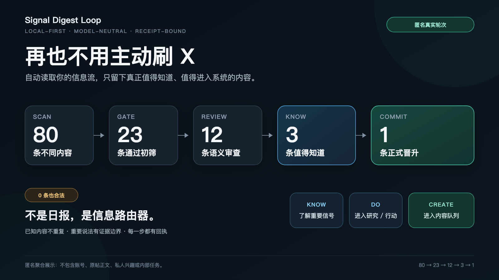
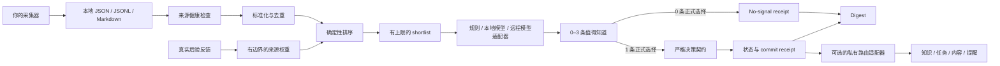

# Signal Digest Loop

简体中文 · [English](README.md)

> 用 AI 安装：把这句话发给你的 AI —— *按照 https://github.com/runesleo/x-signal-digest/blob/main/install.md 的官方说明，在这台电脑上安装 Signal Digest Loop。*

> **再也不用主动刷 X。**
>
> 让程序读取你自己的采集器导出的信息流（本仓库不自带 X 采集器），检查来源、去重和筛选；每轮只留下 0–3 条真正值得知道的内容，并且最多允许 1 条进入你的知识、行动或内容系统。

Signal Digest Loop 是一个**本地优先、模型中立、可审计**的信息消化内核：

```text
输入 → 来源健康 → 去重 → 排序 → 0–3 条值得知道 → 0/1 正式晋升 → 路由 → 摘要 → 反馈
```



它不是又一份读完就消失的 AI 日报。它允许这一轮没有任何内容值得进入系统，也要求每一次正式晋升都留下可核验的回执。

## 一次真实但匿名的运行

```text
142 次来源命中
  ↓ 去重
80 条不同内容
  ↓ 相关性与质量门
23 条通过机器初筛
  ↓ 有上限的语义审查
12 条进入 shortlist
  ↓ 证据、记忆差异与实际用途判断
3 条值得知道
  ↓ 正式写回契约
1 条正式晋升
```

另外两条并没有消失：它们仍出现在“值得知道”报告里，只是因为证据不足或没有形成新的可验证知识，没有被包装成行动或正式结论。

完整边界见[匿名案例](docs/anonymous-x-case-study.md)。

## 30 秒体验

只需要 Python 3.11 或更高版本：

```bash
python3 demo.py
```

不需要安装依赖，不需要账号、API key 或网络。样例只使用虚构的本地数据，并在隔离的临时目录里运行。

如果要请一位非作者验证“10 分钟内跑出第一份摘要”，使用[首位外部测试者任务卡](docs/first-external-tester-zh-CN.md)。任务卡只允许虚构离线样例，并明确禁止公开分享或接入私人数据。

你会看到类似结果：

```text
Signal Digest Loop — offline sample
No install · no account · no key · no network

Sources healthy:     1/1
Items normalized:    3
Items deduplicated:  3
Semantic shortlist:  3
Worth knowing:       3
Formal promotions:   1
```

需要机器可读输出时运行：

```bash
python3 demo.py --json
```

### 摘要输出

JSON 摘要保留原有正式晋升字段，并新增：

- `round_review_count`：包含有效分层审查的轮次数；
- `worth_knowing_count`：值得知道的总条数；
- `worth_knowing_entries`：与 packet、receipt 绑定的逐条认知层结果。

Markdown 会先展示“值得知道”的证据状态、证据边界和利用建议，再单独展示正式晋升。因此即使本轮正式晋升为 0，有价值的信息也不会从摘要中消失。

## Agent Skill

[`skills/x-signal-digest`](skills/x-signal-digest/SKILL.md) 已把这套流程封装成兼容开放 Agent Skills 规范的 Skill，供支持该规范的 AI 客户端使用。它包含可移植预检、虚构离线演示、真实 X 接入边界、0–3 / 0–1 报告契约，以及可选 scheduler 与 MCP 的说明。

```bash
python3 skills/x-signal-digest/scripts/preflight.py --mode demo --json
python3 skills/x-signal-digest/scripts/run_demo.py
```

Skill 是用户入口，不是后台服务，也不是 X 登录工具。单独安装时可以运行便携的虚构契约演示；真实接入仍需要 companion CLI、用户自己选择的只读 collector 和一个已经登录 X 的本机浏览器 profile。scheduler 必须由使用者明确确认后安装，MCP 只是读取本地产物与确认反馈的可选窄接口。

## 为什么要分成“值得知道”和“正式晋升”

大多数信息工具只有一个出口：要么推给你，要么丢掉。Signal Digest Loop 把认知和行动拆成两层。

### 0–3 条值得知道

这是人的认知层。每条内容必须说明：

- 为什么值得你知道；
- 当前证据是已核验、作者自述、混合还是不足；
- 证据边界在哪里；
- 适合从业务、产品、策略、研究、内容、工作流或学习中的哪个角度利用；
- 现在利用、以后利用，还是并不适合。

它只负责让你看见，不自动创建任务，也不授予任何行动权限。

### 0/1 条正式晋升

这是系统状态层。每轮最多 1 条；如果没有内容同时通过证据、相关性、知识增量、用途和安全门，正确答案就是 0。

正式晋升必须绑定本轮 shortlist，并写清：

- 核心主张与证据；
- 对现有目标或资产的关系；
- 相对已有记忆的新旧差异；
- `discard / observe / learn / act / content` 处置；
- 时效、成本和安全门；
- 不可变的 commit receipt。

`selection=null` 时，正式层必须严格 inert：不能夹带 claims、route、novelty、未来时效或待办。但认知层仍可保留 0–3 条值得知道的信息。

## 工作方式



公共内核本身不联网、不登录任何网站，也不把 route 变成真实动作。采集器和下游消费者都在它的边界之外。

## 它不是什么

- 不是 X 登录器或 Cookie 管理器；
- 不是内置爬虫；
- 不是自动发帖、发消息或部署工具；
- 不是会为了填满日报而强行制造结论的摘要器；
- 不是云端托管服务；
- 不是绑定某一家模型的 Agent 框架。

真实的个人 X 部署可以把 For You、Following 或搜索结果写成本地输入文件，但账号状态、采集实现和私人兴趣都不属于公共仓库。

## 安装 CLI

```bash
python3 -m venv .venv
. .venv/bin/activate
python -m pip install -e .
```

先预览，不写正式回执和 processed state：

```bash
signal-digest cycle \
  --config examples/config.toml \
  --allow-command-analyzer
```

确认后在本地应用本轮结果：

```bash
signal-digest cycle \
  --config examples/config.toml \
  --allow-command-analyzer \
  --apply
```

从 commit receipts 生成摘要：

```bash
signal-digest digest --config examples/config.toml --format markdown
```

## 接入自己的信息源

### 1. 让采集器写本地文件

内核支持 JSON、JSONL 和 Markdown。采集器可以来自 RSS、API、数据库导出、邮件导出、浏览器自动化或你自己的脚本。

推荐先写临时文件，再原子替换正式文件，避免消化环读到半份数据。

### X 采集的平台风险（接入前必读）

用浏览器登录态读取 X（例如 `xreach`）不是 X 官方 API，可能违反 X 的服务条款，账号有被限流、要求验证或封禁的风险。本项目不提供、不推荐任何绕过限制的做法，风险由使用者自行承担。建议：

- 只读、低频：单次几十到一两百条，间隔数小时，不并发、不轮换代理；
- 不用于点赞、关注、发帖、私信等任何写操作；
- 能用官方 API、RSS 或手动导出就优先用它们；
- 主力账号谨慎使用，出现验证或限流提示立刻停止。

### 示例：从 xreach 导出转换

`examples/adapters/` 里有一个离线转换脚本，只重排你已经导出的文件，不联网、不读 Cookie：

```bash
xreach home -n 100 --json > feed.json
python3 examples/adapters/xreach_to_jsonl.py feed.json --output signals.jsonl
```

再把 `examples/adapters/xreach.config.toml` 里的 `[[sources]]` 段落复制到你的私有 config。默认跳过转推，`--include-retweets` 可保留。输入不是正常导出（比如限流报错）时脚本以状态 2 退出，不会覆盖上一次的有效文件。

### 2. 配置字段映射和来源健康

```toml
[[sources]]
name = "my-feed"
type = "json"
path = "sources/feed.json"
items_path = "items"
weight = 1.0
freshness_hours = 24
enabled = true

[sources.fields]
title = "title"
url = "url"
text = "summary"
engagement = "engagement"
```

缺失、过期、解析失败、部分成功和健康来源会被分别记录，不会把基础设施故障伪装成“今天没有好内容”。

### 3. 连接任意 analyzer

Analyzer 只需要遵守一个 JSON stdin/stdout 契约：

- 从 `stdin` 读取一个 packet；
- 向 `stdout` 输出一个 decision；
- 返回 0–3 条 packet-bound `worth_knowing`；
- 正式选择为 `null` 或一个 shortlist candidate ID；
- 失败时返回非零退出码，不能悄悄降级成“0 条”。

Analyzer 可以是确定性规则、本地模型，也可以是你为任意远程模型编写的小型客户端。内核不知道、也不需要知道它后面是哪家模型。

协议全文见[Analyzer Protocol](docs/analyzer-protocol.md)。

### 4. 按需消费回执

正式 commit receipt 是唯一稳定的下游接缝。私有适配器可以把其中的 route 映射到知识库、任务系统、内容队列或通知渠道。

Route 只是标签，不是权限。任何发布、发消息、部署、付费或其他外部动作，都必须由下游适配器另设审批和幂等边界。

## 模型中立意味着什么

确定性内核负责：

- 输入与来源健康；
- 标准化、去重和排序；
- shortlist 上限；
- 0–3 / 0–1 契约校验；
- receipts、digest 和反馈状态。

模型适配器只负责语义判断。只要输出同一份协议，Claude、Codex、Cursor、本地模型或规则程序都可以执行同一轮，而不需要分叉数据库或建立多套 backlog。

## 公共内核与私人系统的边界

| 公共内核 | 私人适配层 |
| --- | --- |
| JSON / JSONL / Markdown reader | 登录态采集器与 API client |
| 来源健康、标准化、去重和排序 | 私人来源列表、账号与兴趣配置 |
| 0–3 round review 与 0/1 formal decision | 私人目标、记忆和模型 prompt |
| 本地 state、receipts、digest 与反馈 | 知识库、任务、内容和通知路由 |
| 默认关闭的调度示例 | 已安装的 scheduler 与运行告警 |

公共仓库不需要任何真实私人数据即可完成测试。

## 安全与隐私默认值

- 无网络请求、浏览器控制或账号访问；
- 不发现、不读取凭证；
- 不上传 telemetry；
- 不自动发布、发消息、部署、购买、交易或删除；
- 不安装或启用 scheduler；
- `cycle` 默认 dry-safe，只有显式 `--apply` 才 commit；
- Analyzer command 默认禁用，必须显式传入 `--allow-command-analyzer`；
- Analyzer 以参数数组启动，`shell=False`，并限制运行时间与输出大小；
- 无效输出 fail closed，不会被“修复”为一个看似正常的决定；
- 来源文件有大小、行数、行长、错误数和嵌套深度限制；
- 绝对路径不会写进公开 packet；
- state 与 receipts 可能含敏感摘要和 URL，应留在私有目录并设置保留策略。

Analyzer 是受信任的本地可执行程序，并不在内核内沙箱化。只配置你自己审查过的命令。完整说明见[安全与隐私](docs/security-and-privacy.md)。

## 命令一览

```text
signal-digest init      生成安全的初始配置
signal-digest prepare   健康检查、标准化、去重、排序并生成 packet
signal-digest commit    校验并提交一个 packet-bound decision
signal-digest cycle     一次完成 prepare、analyze；仅 --apply 时 commit
signal-digest digest    从不可变 commit receipts 生成摘要
signal-digest feedback  预览或应用有边界、可逆的来源权重调整
```

## 当前阶段

这是 alpha 版本的公共内核。目前已经具备：

- 纯 Python 标准库实现；
- 一条命令的虚构离线样例；
- JSON / JSONL / Markdown intake；
- 来源健康、去重、排序与 processed TTL；
- 0–3 round review；
- 严格的 0/1 decision contract；
- 原子、幂等的 receipts；
- receipt-only digest；
- 有边界、可逆的 feedback；
- 无私人实例字符串的回归检查。

下一阶段重点不是立刻做云端 SaaS，而是先验证三件事：陌生用户能否快速跑出第一份 digest、个性化结果是否持续有用、它是否真的减少了主动刷信息流的时间。

## 已验证

- `python3 -m unittest discover -s tests`：20 个测试全过，Python 3.11+，不联网、不需要账号。
- `python3 demo.py` 离线跑出一份虚构摘要（3 条值得知道、1 条正式选择）；Skill 入口 `skills/x-signal-digest/scripts/run_demo.py` 找到内核时会报告 `kernel_exercised=True`。
- 用虚构的 xreach 导出，经 `examples/adapters/xreach_to_jsonl.py` 转换后完整跑过一轮 `signal-digest cycle`（预演）：来源 `healthy`，挑出 1 条。
- 一次真实但已脱敏的运行见上文「一次真实但匿名的运行」。

## 已知限制（v0.1）

- 不自带 X 采集器，需要你自己选一个只读采集器（例如 xreach），并自行承担平台风险。
- 自带的 analyzer 是规则版，只用于演示；真实使用要接你自己的模型命令。
- 单机、基于文件的状态，没有多用户或云端模式。
- 还没发到 PyPI，需要从源码安装。
- 幂等只覆盖完全相同的决定：同一个 packet 提交两个不同决定都会成功，请保证每个 packet 只跑一个 analyzer。
- 自带的规则版 analyzer 可能从前三条以外选行动项而被内核拒绝；它只是演示，不是生产 analyzer。
- 来源健康里的部分报错文字仍可能带文件名，分享 packet 前请先检查。

## 路线图

- 更多采集适配：RSS、Telegram 导出、Markdown 笔记。
- 一个参考版 LLM analyzer，兼容 OpenAI 格式或 Anthropic 接口。
- 每周反馈汇总：哪些来源真正产出了被采纳的内容。

## 关于作者

*Leo（[@runes_leo](https://x.com/runes_leo)）— AI × Crypto 独立构建者。在 [Polymarket](https://polymarket.com/?via=runes-leo&r=runesleo&utm_source=github&utm_content=x-signal-digest) 做量化，用 Claude Code 和 Codex 搭数据与内容管线。*

*[leolabs.me](https://leolabs.me) — 写作 · 社群 · 开源工具 · 独立项目*

*[X 订阅](https://x.com/runes_leo/creator-subscriptions/subscribe) — 付费内容周刊*

*Learn in public, Build in public.*

## License

[MIT](LICENSE)
